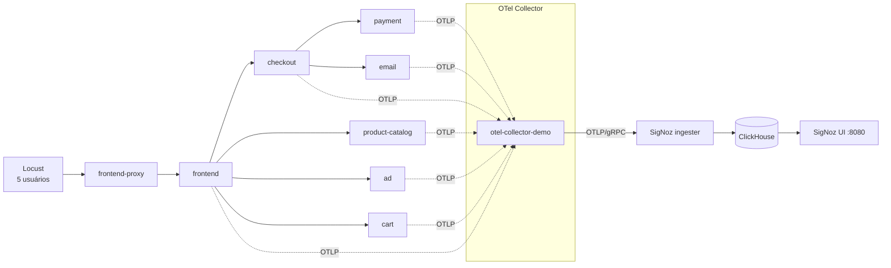

# Monitoramento de desempenho de uma aplicação com SigNoz (APM)

**Disciplina:** _[preencher]_ · **Prof.:** Robson Gomes · **Atividade prática da Aula 11 (APM) – G2**
**Integrantes:** _[preencher nomes, até 4]_
**Data da execução dos experimentos:** 26/10/2026

---

## 1. Objetivo

Monitorar o desempenho de uma aplicação **já implantada** (sem desenvolvê-la) com uma ferramenta de APM, injetar falhas típicas de produção e mostrar como a ferramenta detecta, localiza e ajuda a diagnosticar cada uma, usando os conceitos da aula: métricas, traces e logs, método RED, MTTD e MTTR.

## 2. Ambiente

| Item | Escolha |
|---|---|
| Ferramenta de APM | **SigNoz v0.147.0**, open source, auto-hospedado. Backend ClickHouse, UI única para métricas, traces e logs. Instalado com o `foundryctl` (método oficial desde a v0.130; o `install.sh` antigo está depreciado) |
| Instrumentação e coleta | **OpenTelemetry** (SDKs nos serviços e Collector). O Collector do demo exporta por OTLP/gRPC para o ingester do SigNoz |
| Aplicação monitorada | **OpenTelemetry Demo** (loja virtual de microsserviços, projeto da CNCF). Três serviços de entrada (`frontend-proxy`, `frontend`, `frontend-web`) e backends como `cart`, `checkout`, `payment`, `product-catalog`, `ad`, `email`, `shipping`, `currency`, `recommendation` e `quote`, além do `redis` (valkey) e do `flagd`. Serviços escritos em várias linguagens |
| Gerador de carga | Locust, que já vem no demo, com 5 usuários simultâneos (padrão do demo) |
| Injeção de falhas | Feature flags do demo, servidas pelo `flagd`, que recarrega o JSON em tempo real |
| Infraestrutura | Docker Desktop em macOS arm64 (10 CPUs, 8 GB), na mesma máquina do SigNoz |

Total: 17 serviços aparecem no SigNoz e o mapa de dependências foi montado automaticamente (`evidencias/08-service-map.png`).



### 2.1 Passos de implantação

1. SigNoz: `casting.yaml` (`flavor: compose`, `mode: docker`) e `foundryctl cast`. O ingester foi remapeado para as portas 14317/14318 por um `compose.override.yaml`, porque 4317/4318 já estavam em uso por outro container da máquina.
2. Demo: o `compose.yaml` base (sem Kafka e sem a stack Jaeger/Prometheus/Grafana do próprio demo). O exporter do SigNoz foi adicionado na camada `otelcol-config-extras.yml` do Collector e a porta do proxy foi alterada para 8081.
3. Na primeira tentativa, a telemetria não chegava ao SigNoz. Com `host.docker.internal:14317`, o Collector do demo recebia `error reading server preface: EOF`. A correção foi conectar o Collector do demo à rede `signoz-network` e usar `signoz-ingester:4317`. Além disso, o ingester só abre o receptor OTLP depois que o servidor SigNoz lhe entrega a configuração via OpAMP, e o servidor registrava `failed to find or create agent` até a **conta de administrador** ser criada na UI. Criada a conta, os spans passaram a chegar (cerca de 20 mil na primeira checagem).

## 3. Metodologia

Cada cenário durou 4 minutos, com 30 a 60 s de pausa entre eles. Foi executado por `scripts/cenarios.sh`, que alterna a flag, aguarda e a desliga, registrando os horários UTC em `cenarios.log`. Os números abaixo vêm dos spans de entrada (`kind = SERVER`) armazenados no ClickHouse do SigNoz, consultados por `scripts/janelas.sh`.

| # | Janela (UTC) | Cenário | Flag |
|---|---|---|---|
| 0 | 22:41–22:45 | **Baseline** | nenhuma |
| 1 | 22:45–22:49 | Falha de pagamento (50%) | `paymentFailure = 50%` |
| 2 | 22:50–22:54 | Imagens lentas (5 s) | `imageSlowLoad = 5sec` |
| 3 | 22:55–22:59 | Falha no catálogo de produtos | `productCatalogFailure` (produto `OLJCESPC7Z`) |
| 4 | 23:00–23:04 | CPU alta no serviço de anúncios | `adHighCpu = on` |
| 5 | 23:05–23:09 | Vazamento de memória no e-mail | `emailMemoryLeak = 10000x` |

Os gráficos do SigNoz estão com fuso UTC−3 (19:41 a 20:10), com o intervalo **Last 1 hour**.

## 4. Resultados

### 4.1 Baseline (linha de base)

Sem falhas: **0 erros** em todos os serviços e latências baixas.

| Serviço | Reqs | Erros | p50 (ms) | p95 (ms) |
|---|---:|---:|---:|---:|
| frontend | 3232 | 0 | 4,6 | 53,9 |
| checkout | 16 | 0 | 58,9 | 127,6 |
| payment | 16 | 0 | 2,5 | 4,6 |
| product-catalog | 1265 | 0 | 9,6 | 41,6 |
| ad | 98 | 0 | 5,3 | 12,3 |
| email | 16 | 0 | 9,6 | 25,2 |

Esses valores são a referência para os cenários. Sem uma linha de base não há como afirmar que uma latência de 150 ms é alta ou normal.

### 4.2 Cenário 1: falha de pagamento (taxa de erros)

| Serviço | Erros | % erro | p95 (ms) |
|---|---:|---:|---:|
| payment | 8 / 13 | **61,5%** | 13,2 |
| checkout | 8 / 13 | **61,5%** | 117,1 |
| frontend | 0 / 3230 | 0% | 59,4 |

- O erro **não aparece nas métricas do `frontend`** (0%): ele só fica visível em `checkout` e `payment`. Sem APM ponta a ponta, quem olhasse só o front-end e a infraestrutura veria tudo saudável. É exatamente a diferença "O servidor está saudável?" × "O usuário está sendo bem atendido?" dos slides.
- O trace (`evidencias/09-trace-pagamento-falha.png`, trace `70485c7dc3e3…`) mostra a cadeia `checkout → PlaceOrder → payment → Charge` com a mensagem **"Payment request failed. Invalid token"**. O trace localiza o serviço e a mensagem de erro explica a causa, o que cobre o "métrica acende o alerta, o trace localiza, o log explica".
- A amostra é pequena (13 pedidos em 4 min), então 61,5% convive com os 50% configurados sem contradição.

### 4.3 Cenário 2: imagens lentas (latência)

Nas rotas `/images/products/*.jpg` do `frontend-proxy`:

| | Reqs | p50 (ms) | p95 (ms) |
|---|---:|---:|---:|
| Baseline | 781 | 1 | 3 |
| Imagens lentas | 355 | **2983** | **5008** |

- O p95 geral do `frontend-proxy` passou de 49 ms para **5004 ms**. A queda de reqs (781 → 355) reflete o menor volume atendido enquanto cada imagem demora segundos.
- Atenção a uma armadilha de leitura: o p95 e o máximo do `frontend-proxy` também são puxados por chamadas `POST /flagservice/…/EventStream`, conexões de longa duração (10 s) do flagd que **não** são lentidão. A primeira reação a um número alto é abrir o trace (`evidencias/11-trace-lento-5s.png`): aqui o trace de imagem mostra 5,0 s gastos no `frontend-proxy`, com o `image-provider` respondendo em milissegundos ao final. Ou seja, o atraso está antes do backend e não no código do serviço de imagens.
- Sem erro HTTP (todos 200). Uma lentidão assim passa despercebida em um monitor de "está no ar", mas aparece na percentil de latência.

### 4.4 Cenário 3: falha no catálogo de produtos (erros em cascata)

| Serviço | Erros | % erro |
|---|---:|---:|
| product-catalog | 959 / 1364 | **70,3%** |
| frontend | 754 / 2939 | **25,7%** |
| frontend-proxy | 377 / 2664 | **14,2%** |
| checkout | 2 / 3 | 66,7% |

- O erro se propaga do backend (70%) para o front-end (26%) e para a borda (14%), e o volume de `checkout` desabou de 16 para 3 pedidos na janela. É a "falha intermitente" dos slides, com a vantagem de ver quanto cada camada herda.
- O trace (`evidencias/10-trace-catalogo-falha.png`, trace `794e7788a754…`) mostra `ProductCatalogService/GetProduct` com **"Error: Product Catalog Fail Feature Flag Enabled"**, de onde sai a causa raiz em um clique.
- Não investiguei por que a taxa no `product-catalog` chega a 70% embora a flag mire um único produto; o Locust visita esse produto com frequência e provavelmente há retentativas. Reporto o número medido e não a explicação.

### 4.5 Cenário 4: CPU alta no serviço de anúncios (degradação por dependência)

| Serviço | p95 baseline (ms) | p95 com falha (ms) | Fator |
|---|---:|---:|---:|
| ad | 12,3 | **152,8** | 12× |
| product-catalog | 41,6 | 220,8 | 5,3× |
| frontend | 53,9 | 253,4 | 4,7× |
| checkout (p50) | 58,9 | **480,4** | 8,2× |
| checkout (p95) | 127,6 | **1141,7** | 8,9× |
| email | 25,2 | 213,1 | 8,5× |

- A métrica de container `container.cpu.utilization` do `ad` (coletada pelo receiver `docker_stats`) subiu de ~0 para 0,7 ao longo da janela (unidade do receiver). **Todos os serviços ficaram mais lentos**, e não só o `ad`: sob contenção de CPU na mesma máquina a lentidão contamina o resto ("terceiro lento contamina tudo").
- Limitação: como tudo roda em um único host Docker de 8 GB, parte do efeito é contenção de recursos do host e não dependência lógica entre serviços. Em produção real o sinal costuma ser mais isolado.

### 4.6 Cenário 5: vazamento de memória no serviço de e-mail

| Métrica | Valor |
|---|---|
| Memória do container `email` (média por minuto) | **32,9 MB (23:03) → 72,4 MB (23:09)**, 2,2× em 6 min; limite do container: 100 MiB |
| p95 do `email` | 25,2 ms → **978 ms** |
| p95 do `checkout` | 127,6 ms → 1634 ms |
| Reinícios do container | 1 (`docker inspect`; `OOMKilled=false`, então não afirmo que foi OOM) |

- A memória cresce de forma monotônica enquanto a flag está ligada e cai logo depois (57 MB às 23:10, 47,6 MB às 23:11), o formato da "serra" da aula (Heap crescendo até o limite → reinício).
- Limitação: na janela só houve 6 envios de e-mail, e a janela vem logo após o cenário de CPU, então parte da latência pode ser resíduo de contenção do host. A tendência de memória é o sinal mais confiável deste cenário.

### 4.7 Visão consolidada

| Cenário | Sinal que o APM mostrou | Onde ver no SigNoz |
|---|---|---|
| Pagamento 50% | Erros em `payment` e `checkout`, invisíveis no `frontend` | Services → checkout / payment; Trace |
| Imagens lentas | p50/p95 de 1/3 ms para ~3/5 s, sem erro | Services → frontend-proxy; Trace |
| Catálogo | Erros em cascata 70% → 26% → 14% | Services → product-catalog; Trace |
| CPU do `ad` | p95 de `checkout` 9×, `frontend` 5× | Services → checkout; Metrics |
| Vazamento do `email` | Memória 33 → 72 MB; p95 do `email` 39× | Metrics (container.memory.usage.total) |

## 5. Uso da ferramenta (SigNoz)

- **Services** (`evidencias/01-services-lista.png`): lista dos 17 serviços com p99, taxa de erro e operações por segundo, o ponto de partida do método RED.
- **Página de cada serviço** (`02` a `07`): gráficos de latência (p50/p90/p99), taxa de operações, Apdex e "Key Operations" com p50/p95/p99, chamadas e taxa de erro por operação. O Apdex do `frontend` despenca nos cenários de falha (visível em `02-service-frontend.png`).
- **Service Map** (`08-service-map.png`): grafo de dependências gerado automaticamente, com serviços em vermelho quando há erro.
- **Traces** (`09`, `10`, `11`): flame graph e waterfall por requisição, com mensagem de erro do span.
- **Metrics**: métricas de container (CPU, memória) enviadas pelo mesmo Collector, na mesma ferramenta, correlacionadas com os traces.

## 6. Análise crítica

- **Detecção × diagnóstico:** as métricas apontaram *que* algo estava errado (erro, p95, memória) e o trace apontou *onde* e *por quê* (serviço, span, mensagem). Em todos os cenários foi possível chegar à causa em poucos cliques; isso é o ganho de MTTR da aula (detecção e diagnóstico, não a correção).
- **Falhas que o monitoramento de infraestrutura não pega:** pagamento falhando com `frontend` em 0% de erro, e imagens com 5 s de latência e HTTP 200.
- **Cuidado com agregados:** p95/máximo de um serviço podem misturar tráfego que não é de usuário (EventStream do flagd). Ler por operação/rota evita falso alarme.
- **Limitações do experimento:** carga baixa (5 usuários), amostras pequenas em `checkout`/`payment` (13 a 16 pedidos por janela), uma única execução de cada cenário, host único com contenção entre serviços, e janelas de 4 min. Os números são ilustrativos e não estatisticamente conclusivos.
- **Não feito:** não configurei regras de alerta no SigNoz (MTTD por alerta). Seria o próximo passo natural.

## 7. Recomendações (como corrigir o que o APM mostrou)

| Problema | Ação |
|---|---|
| Falha em `payment` | Timeout e retentativa limitada no `checkout`, circuit breaker, e alerta de taxa de erro no `payment` |
| Imagens lentas | Cache/CDN para ativos estáticos e timeout no proxy; alerta de p95 por rota |
| Catálogo com erro | Fallback/cache do catálogo e alerta de taxa de erro por operação |
| CPU do `ad` | Limites de CPU por container e autoescala; isolar o serviço não crítico dos críticos |
| Vazamento do `email` | Corrigir a retenção de objetos; alerta de crescimento de memória (próximo ao limite) para reagir antes do reinício |

## 8. Reprodução

```bash
# SigNoz
cd signoz && docker compose -p signoz -f pours/deployment/compose.yaml -f compose.override.yaml up -d   # UI: http://localhost:8080
# Aplicação
cd otel-demo && docker compose -f compose.yaml -f ../otel-demo.override.yaml up -d                       # loja: http://localhost:8081
# Cenários e consulta dos números
scripts/cenarios.sh   # ~30 min, grava cenarios.log
scripts/janelas.sh    # tabela por janela, via ClickHouse do SigNoz
```

## 9. Conclusão

O SigNoz, alimentado por instrumentação OpenTelemetry, permitiu observar a loja ponta a ponta e identificar cada uma das cinco falhas injetadas: erros (pagamento, catálogo), latência (imagens), degradação por CPU e vazamento de memória. A combinação de métricas, traces e mapa de dependências mostrou o que o monitoramento de infraestrutura sozinho esconderia, como erro sem queda de CPU e lentidão com HTTP 200. Os resultados são de um ambiente local de baixa carga e devem ser lidos como demonstração da técnica.

## Referências

- Aula 11 – Monitoramento de Performance de Aplicações (APM), Prof. Robson Gomes.
- SigNoz: https://signoz.io/docs/install/docker/
- OpenTelemetry Demo: https://github.com/open-telemetry/opentelemetry-demo
